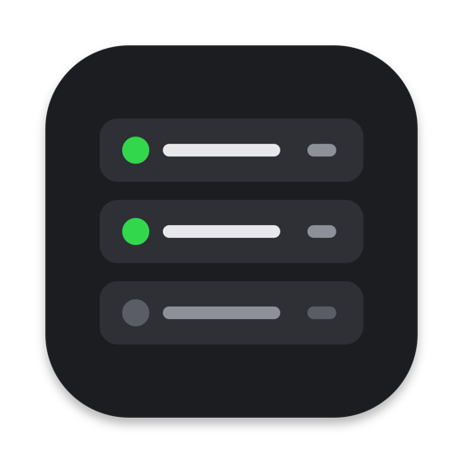

  

<h1 align="center">Deck</h1>

Deck is a native macOS menu bar app for developers. It finds the dev servers you already
have running, works out how each one was started, and lets you save, stop, start and restart
them in one click, with no setup.

## Download

Get **Deck-0.5.0.dmg** from [Releases](../../releases/latest), open it, and drag Deck to
Applications.

- macOS 14 Sonoma or later, Apple silicon and Intel
- Signed with a Developer ID and notarized by Apple
- About 15 MB of memory and no CPU use while idle

Deck lives in the menu bar only. **Open Deck** in its popover shows a full window, and a
Dock icon appears only while that window is open.

## What it does

- **Finds running services.** Every TCP port your user is listening on, with its process,
  PID and bind address. System and app listeners (AirPlay, Spotify, Docker) are kept apart
  under Other.
- **Traces how each was started.** For `npm run dev` it finds `npm run dev`, not the `node`
  child that owns the port, plus the folder it ran in and the project it belongs to.
- **Saves it in one click.** Then start, stop and restart it from the menu bar, whether it
  was started by Deck or in a terminal. Stop ends the whole process tree and never your
  terminal.
- **Status and logs.** Running, Starting, Stopped or Crashed with the last log lines. For
  services Deck starts, output goes to a live log panel. Services keep running when Deck
  quits, and Deck picks them up again on relaunch.
- **Add services by hand.** New Service suggests start commands from the project's files
  (`package.json` scripts, `manage.py`, `Cargo.toml`, `go.mod`, Procfile and more).
- **Run services on other machines over SSH.** Pick a host from `~/.ssh/config` and choose
  **SSH + port forward** (the port is tunnelled to `localhost` on your Mac) or **purely
  remote**. Start, stop, restart, status and live logs work the same as for local services.
  Deck uses your SSH keys and agent only and never asks for or stores a password.
- **Flags exposure.** A badge when a service listens on `0.0.0.0` or `::`, so it's reachable
  from your network, not just this Mac.
- **Settings.** Launch at login, start chosen services with Deck, ignore ports or processes,
  and choose whether quitting Deck stops its services.

## Privacy

Deck makes no network connections of its own: no telemetry, no analytics, no update checks.
The only connections are the SSH sessions you set up for remote services. It reads
process information through macOS's own process APIs and never runs `lsof` or `ps`. It is
not sandboxed, because inspecting other processes and starting commands requires that.

Deck keeps its data in your home folder:

| What | Where |
| --- | --- |
| Saved services (commands it may run) | `~/Library/Application Support/Deck/services.json` |
| Processes Deck started, for re-attaching | `~/Library/Application Support/Deck/state.json` |
| Remote services Deck started | `~/Library/Application Support/Deck/remote.json` |
| Service output | `~/Library/Logs/Deck/` (remote services: `~/.deck/logs/` on the host) |

Nothing starts automatically unless you turn on **Start when Deck launches** for that
service, and never from a `services.json` that other users can edit.

## Uninstall

Quit Deck, move it from Applications to the Trash, and optionally delete the folders above.

## Source code

Deck isn't open source yet; the source will be published later. Until then this repository
holds releases only. Bug reports and ideas are welcome in [Issues](../../issues).

© 2026 Aditya Patil. All rights reserved.
